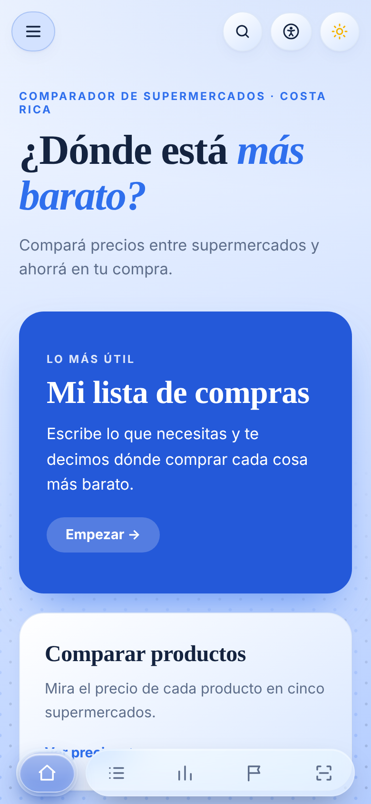
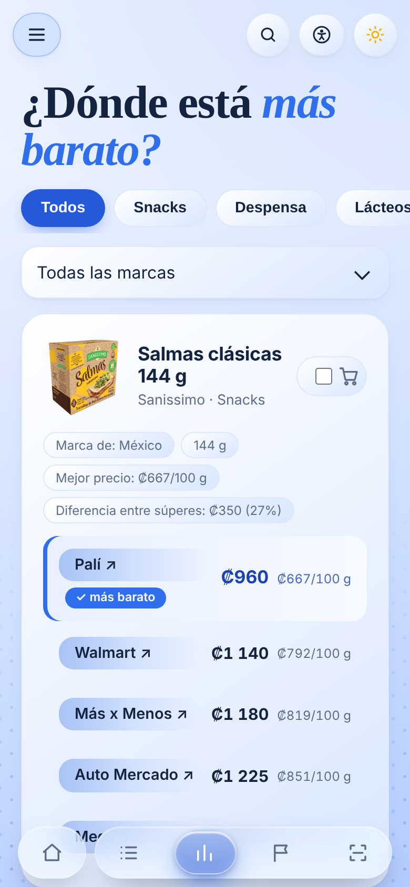
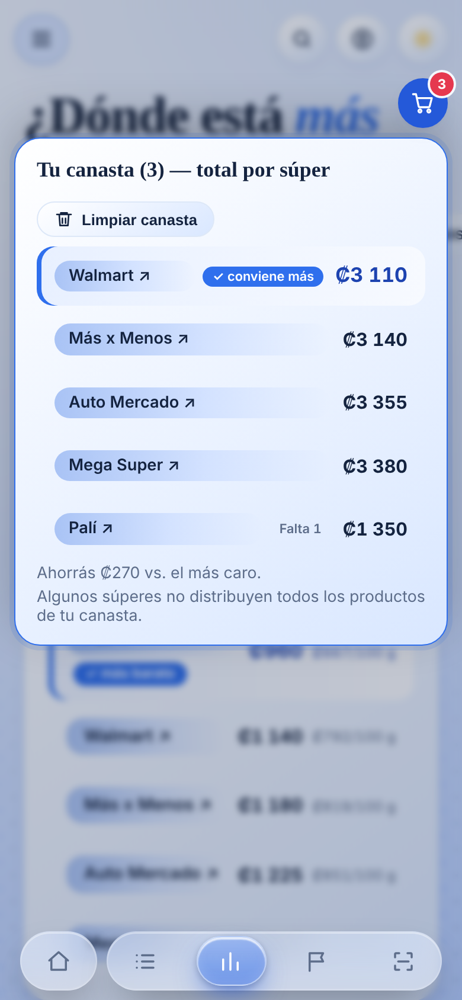
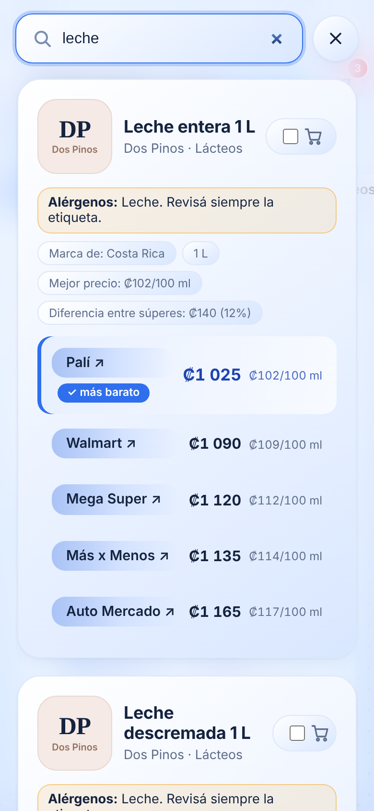

# ¿Dónde está más barato?

Aplicación web para comparar precios de productos básicos entre supermercados de Costa Rica (Palí, Walmart, Mega Super, Más x Menos, Auto Mercado).

  
  
  
  

## Qué hace

- Compara cada producto entre súperes y resalta el más barato.
- Canasta con el total por súper y cuánto se ahorra.
- Escáner con selector de súper y botón para agregar al carrito en el súper que elijas.
- Escáner: el botón «Escanear» de la barra de abajo abre la cámara, lee el código de barras o QR de un producto, muestra su precio en cada súper y deja agregarlo a la canasta.
- Buscador a pantalla completa, lista de compras, marcas nacionales y pymes.
- Modo claro/oscuro y modo de fácil lectura (sin animaciones).
- Se puede instalar en el celular como app (PWA): en el navegador, "Agregar a pantalla de inicio".

## Archivos

| Archivo | Para qué sirve |
|---|---|
| `index.html` | La app completa (HTML, CSS y JS en un solo archivo) |
| `manifest.webmanifest` | Datos para instalarla como app en el celular |
| `zxing.min.js` | Lector de códigos de barras para el escáner (funciona en iPhone y computadora) |
| `sw.js` | Permite que la app abra aunque no haya internet |
| `favicon.ico`, `favicon.svg`, `icons/` | Ícono de la pestaña y de la app (logo del carrito) |
| `og-image.png` | Imagen que aparece al compartir el link |
| `docs/` | Capturas de pantalla de este README |
| `.nojekyll` | Le dice a GitHub Pages que sirva los archivos tal cual |

## Publicar en GitHub Pages

1. Creá un repositorio nuevo en GitHub (por ejemplo `donde-esta-mas-barato`).
2. Subí **todo el contenido** de esta carpeta a la raíz del repositorio, incluyendo las carpetas `icons` y `docs` y el archivo `.nojekyll`.
3. Entrá a **Settings → Pages**, en **Build and deployment** elegí **Deploy from a branch**, la rama `main` y la carpeta `/ (root)`. Guardá.
4. En uno o dos minutos la página queda en `https://TU-USUARIO.github.io/donde-esta-mas-barato/`.
5. Abrí `index.html` y buscá `TU-USUARIO`: reemplazalo (en las dos líneas de `og:image` y `twitter:image`) por tu usuario de GitHub, y ajustá el nombre del repositorio si usaste otro. Así se verá la imagen cuando compartás el link por WhatsApp, Facebook, etc.

## Agregar productos al escáner

Los productos propios están en `const REALES` de `index.html`: nombre, categoría, marca, precios en el orden Auto Mercado, Más x Menos, Walmart, Palí y Mega Super (`null` si no lo venden), `d` para un descuento (`{3:500}` = Palí, precio anterior ₡500) y el código de barras `b`. Después agregá el código en `const BARRAS` (`"código":["Nombre","Marca"]`, igual que en `REALES`) y, si tenés foto sin fondo, en `const IMG` (`"Nombre|Marca":"data:image/..."`). La cámara solo funciona con https (GitHub Pages sirve) y hay que dar permiso al navegador.

## Probar en tu computadora

Abrí `index.html` con el navegador (doble clic).

## Nota

Los precios son datos incluidos en el archivo y pueden estar desactualizados. Revisá siempre el precio en la tienda.
